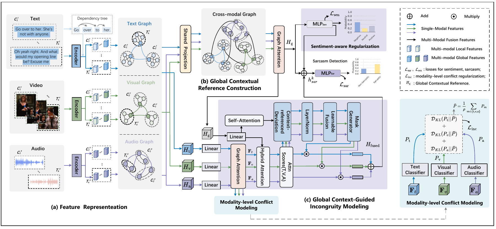

# GCIM-MSD

Code for **Global Context-Guided Incongruity Modeling for Multimodal Sarcasm Detection**. GCIM-MSD performs sarcasm detection with auxiliary sentiment supervision on MUStARD and Memotion.



## Requirements

The recorded environment used Python 3.10.14, PyTorch 1.12.1+cu113, DGL 0.9.1.post1, and Transformers 4.30.2. Install platform-compatible PyTorch and DGL builds first, then run:

```bash
pip install -r requirements.txt
```

Exact recorded versions are listed in `requirements-recorded.txt`.

## Data

Prepare the processed split files and modality features according to [docs/DATASETS.md](docs/DATASETS.md), then check them with:

```bash
python scripts/preflight.py /absolute/path/to/gcim_data
```

## Training

```bash
bash scripts/train_mustard.sh /absolute/path/to/gcim_data
bash scripts/train_memotion.sh /absolute/path/to/gcim_data
```

Launchers read `configs/<dataset>.yaml`, default to CPU, and archive source and settings in a new output directory. Checkpoints are selected on the validation split using:

```text
0.7 * sarcasm weighted F1 + 0.3 * sentiment weighted F1
```

The selected checkpoint is evaluated once on the test split.

For the ablation and modality-removal experiments:

```bash
bash scripts/train_ablation_suite.sh mustard /absolute/path/to/gcim_data
bash scripts/train_ablation_suite.sh memotion /absolute/path/to/gcim_data
```

## Evaluation

Evaluate a checkpoint produced by training with:

```bash
bash scripts/evaluate.sh mustard /path/to/gcim_data \
  /path/to/local/mustard_best_model.pth mustard_evaluation.json

bash scripts/evaluate.sh memotion /path/to/gcim_data \
  /path/to/local/memotion_best_model.pth memotion_evaluation.json
```

## Table III. Main Results

All values are support-weighted percentages on the fixed test splits.

| Dataset | Sarcasm P | Sarcasm R | Sarcasm F1 | Sentiment R | Sentiment F1 |
|---|---:|---:|---:|---:|---:|
| MUStARD | 86.04 | 86.00 | 85.98 | 47.00 | 48.39 |
| Memotion | 69.08 | 76.05 | 71.56 | 55.15 | 49.30 |

Full configurations and experimental settings are available in `configs/` and [docs/REPRODUCIBILITY.md](docs/REPRODUCIBILITY.md).

## Contact and license

Repository maintenance: `teganjay0715@gmail.com`. This code is released under the Apache License 2.0. Dataset and third-party licenses apply separately.
